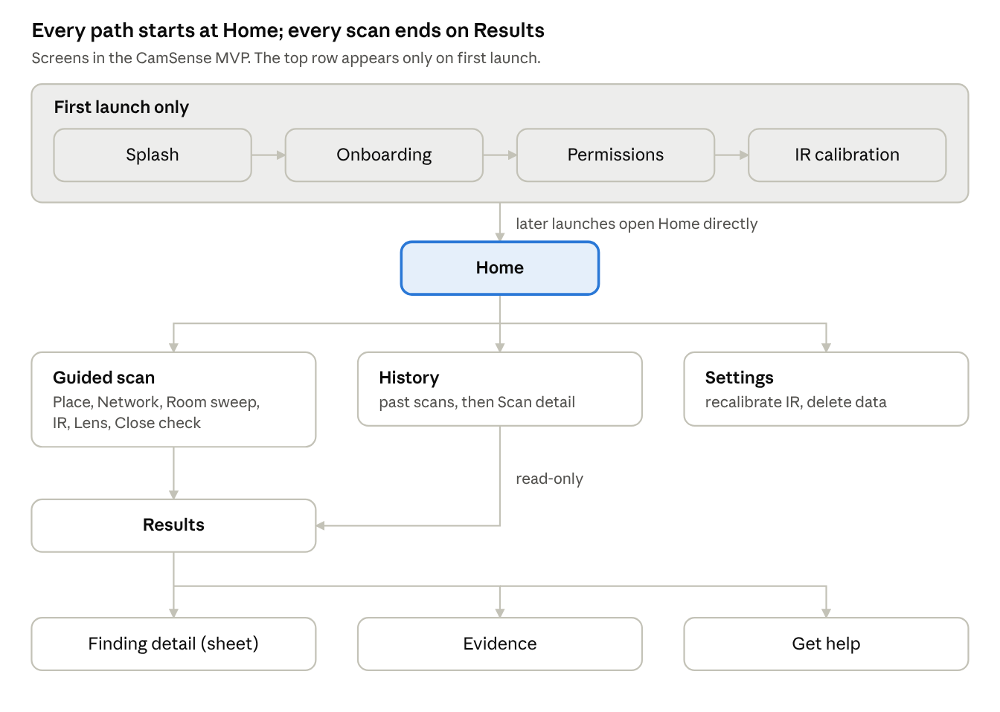
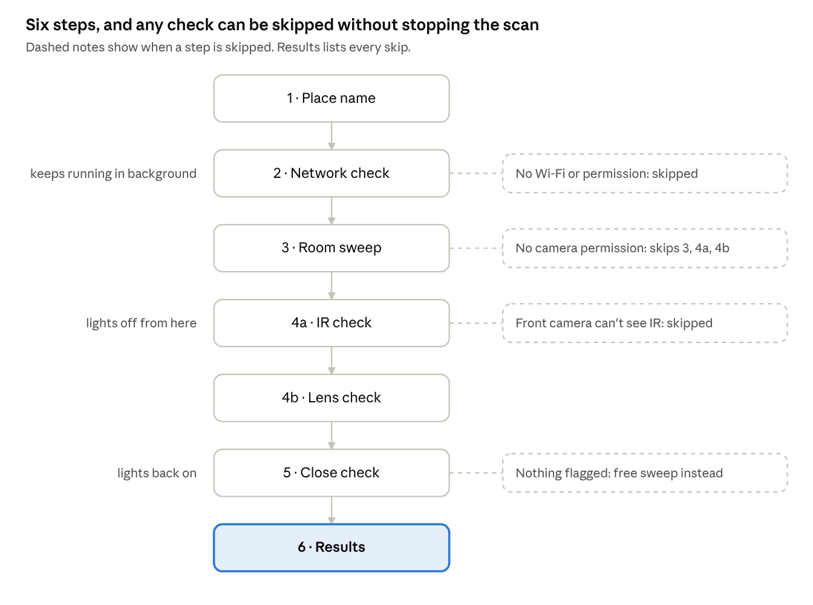

# App Flow: CamSense

Oct 1, 2026 · @Ninad Pandith M N

Every screen in the CamSense MVP and how users move between them. Requirements come from Doc; all on-screen wording comes from Doc.

## App map

App map · 18 screens

Home is the hub: users start a scan, open History or open Settings from it. A scan always ends on Results, and past scans reopen the same Results screen in read-only mode.

## Screen inventory

The MVP has 18 screens in four groups: first launch, home, the guided scan, and after-scan.

| \# | Screen | Purpose | Reached from | Goes to |
|----|----|----|----|----|
| 1 | Splash | Load fonts, model and settings | App launch | Onboarding (first time) or Home |
| 2 | Onboarding | 3 cards: what it does, how it works, its limits | Splash (first launch only) | Permissions |
| 3 | Permissions | Explain, then request camera and nearby devices | Onboarding, or any scan step missing a permission | IR calibration or back to the scan |
| 4 | IR calibration | Test the front camera with a TV remote | Permissions (first launch), Settings | Home |
| 5 | Home | Start a scan, see recent scans | Splash, end of any flow | Place name, History, Settings |
| 6 | Step 1 · Place name | Name the place (optional) | Home | Network check |
| 7 | Step 2 · Network check | Wi-Fi and Bluetooth scan (runs on in background) | Place name | Room sweep |
| 8 | Step 3 · Room sweep | AI marks likely hiding spots, lights on | Network check | IR check |
| 9 | Step 4a · IR check | Front camera looks for night-vision glow | Room sweep | Lens check |
| 10 | Step 4b · Lens check | Torch + rear camera find lens glints | IR check | Close check |
| 11 | Step 5 · Close check | Magnetometer on each flagged spot | Lens check | Results |
| 12 | Step 6 · Results | Risk level, reasons, next steps | Close check, History | Finding detail, Evidence, Get help, Home |
| 13 | Finding detail | Photo, module and reason for one alert (bottom sheet) | Results | Results |
| 14 | Evidence | Saved photos and report for a scan | Results, Scan detail | Results |
| 15 | Get help | Emergency numbers, how to report | Results (High), Settings | Back |
| 16 | History | List of past scans | Home | Scan detail |
| 17 | Scan detail | Read-only Results for a past scan, with delete | History | Evidence, History |
| 18 | Settings | Recalibrate IR, About and limits, Get help, delete all data | Home | IR calibration, Get help |

## First launch and onboarding

First launch takes under a minute: three cards, one permission screen, an optional IR test, then Home. Later launches go straight from Splash to Home.

1.  **Splash** (under 1 s): load fonts, the AI model and settings from DataStore. If onboarding_done is false, go to Onboarding.

2.  **Onboarding cards** (swipe or "Next"; "Skip" on every card):

    1.  "Check any room for hidden cameras": what the app does.

    2.  "Six checks, one result": the guided scan in one sentence and a simple illustration.

    3.  "What a phone can and can't find": the honest limits, from the PRD.

3.  **Permissions screen:** two rows (Camera, Nearby devices), each with the explanation copy from the Content Guidelines, then one "Allow" button that triggers the system prompts.

    - Both allowed → IR calibration.

    - One or both denied → still continue; the affected checks will be skipped and explained on Results.

4.  **IR calibration** (optional): "Point a TV remote at your screen and press any button."

    - Glow detected → save ir_supported = true.

    - Nothing after 15 s, or "Skip" → save ir_supported = false (can redo in Settings).

5.  Save onboarding_done = true and open **Home**.

## Guided scan flow

Guided scan flow · 6 steps

The whole scan takes about 5 minutes. Each step shows one instruction and one button; the button unlocks after a minimum time so users don't rush past a check.

| Step | Screen shows | User does | App does | Moves on when |
|----|----|----|----|----|
| 1 · Place name | Text field, "Next" | Types a name or leaves it blank | Creates the scan row (status RUNNING) | Next is tapped |
| 2 · Network check | Live list of devices found | Waits | Wi-Fi and Bluetooth scans start and keep running through step 3 | Continue is tapped (unlocks after 10 s) |
| 3 · Room sweep | Camera with lime "check this" boxes | Pans slowly around the room | AI marks hiding spots and gives each a target_key | Done sweeping (unlocks after 20 s) |
| 4a · IR check | Front camera, dark preview, orange circles | Turns off lights, turns slowly | Looks for night-vision glows | Next (unlocks after 15 s) |
| 4b · Lens check | Rear camera with torch on, red circles | Scans slowly, can tap to snapshot | Glint detection with tracking; saves snapshots of confirmed glints | Done (unlocks after 20 s) |
| 5 · Close check | Flagged spots list and a live meter | Holds the phone near each spot | Magnetometer readings linked to each spot's target_key | See results is tapped |
| 6 · Results | Risk level, reasons, next steps | Reads and chooses an action | RiskEngine final score; scan saved as COMPLETED | See the Results section |

## Results and after-scan flows

The Results screen layout is the same for every level; only the colour, icon, words and buttons change, as set in the Content Guidelines.

**Layout, top to bottom:** risk level (icon + word), one-line summary, "Why" list of findings (each tappable), "What to do" steps, a list of skipped checks with reasons, the limits caption, then the two buttons.

| Level | Main button | Second action | Extra behaviour |
|----|----|----|----|
| Low | Done → Home | Scan another room → Place name | None |
| Medium | Check flagged spots → Close check (flagged spots only) | Scan again → Place name, same place name prefilled | None |
| High | Save evidence → Evidence | Get help → Get help | One short vibration when the screen opens; evidence is not saved until the user taps |

**Finding detail (bottom sheet)**

1.  User taps a finding on Results.

2.  Sheet shows the snapshot (if any), the module icon and name, the plain-English reason and the confidence.

3.  Two buttons: "Checked, it's fine" (sets user_verdict = CHECKED_OK) and "Looks like a camera" (CONFIRMED).

4.  Marking findings does not change the saved risk score, but Results shows "2 of 4 checked" so the user can track progress.

**Save evidence**

1.  Tap Save evidence → the app writes report.json, keeps the snapshots already taken, and computes a SHA-256 for each file.

2.  Toast: "Evidence saved. Find it in History."

3.  The Evidence screen opens with the photos, the time, the place name and the hashes, plus "Back to results".

**Get help:** a simple screen with 112 (emergency), 1930 (cybercrime helpline) and the cybercrime.gov.in reporting site, each tappable, plus "Don't touch the object; keep your saved evidence." Back returns to where the user came from.

## History and settings flows

**History**

1.  Home → History icon (or "See all" under recent scans).

2.  List of completed scans, newest first: place name (or "Unnamed place"), date and time, risk chip. Empty state: "Your scans will show up here. Start your first scan."

3.  Tap a scan → Scan detail: the same Results layout in read-only mode, with "Evidence" if any was saved.

4.  Delete: overflow menu → "Delete scan" → confirm dialog ("This deletes the scan and its evidence. You can't undo this.") → back to History with a toast.

**Settings**

| Item | Action |
|----|----|
| Recalibrate IR | Opens IR calibration, returns to Settings |
| Permissions | Shows status of Camera and Nearby devices; "Open settings" if denied |
| About and limits | What each check does and what no phone can catch |
| Get help | Opens Get help |
| Delete all data | Confirm dialog → wipes database, evidence folder and settings except onboarding_done |
| Version | App version, for bug reports |

## Edge cases and error states

No error ever stops a scan; the step is skipped, the scan continues, and Results explains what was skipped. The exact wording for each is in the Content Guidelines copy library.

| Situation | Where | What happens |
|----|----|----|
| Not on Wi-Fi | Network check | Wi-Fi part skipped (NO_WIFI); Bluetooth still runs |
| Nearby devices permission denied | Network check | Both Wi-Fi and Bluetooth skipped; "Allow" link opens Permissions |
| Camera permission denied | Room sweep | Steps 3, 4a and 4b skipped; scan jumps to Close check, which uses only the magnetometer |
| IR not supported | IR check | Step 4a skipped automatically, never shown |
| Room too bright | IR or Lens check | Banner asks to darken the room; "Continue anyway" lowers that module's confidence |
| Moving too fast | Any camera step | Banner: "Slow down a little…"; disappears when steady |
| No flagged spots | Close check | Step offers a free sweep: "Hold your phone near anything you're unsure about" |
| No magnetometer on the phone | Close check | Step skipped |
| Model fails to load | Room sweep | Step 3 skipped; logged for debugging |
| Low battery (under 10%) | Home | Warning before starting; scan still allowed |
| Storage full | Save evidence | "Couldn't save evidence. Free up space and try again."; Results stays open |

## Navigation rules

| Event | Behaviour |
|----|----|
| Back during steps 2–5 | Dialog: "Stop this scan? Results so far won't be saved." Stop → scan saved as ABORTED, go Home. Keep scanning → stay |
| Back on step 1 | Return to Home, nothing saved |
| Back on Results | Go to Home (never back into the scan) |
| App sent to background mid-scan | Camera and torch stop; network scan keeps running for up to 30 s; on return the current step restarts |
| Phone call or screen off | Same as background |
| App killed mid-scan | Scan stays RUNNING in the database; on next launch it's marked ABORTED and not shown in History |
| Rotation | Portrait only, every screen |
| Torch | On only during Lens check; turned off on leaving the step for any reason |
| Screen timeout | Kept awake during steps 2–5 |

The scan steps share one ScanViewModel scoped to the scan graph, so results from earlier steps survive moving between steps.

## Navigation routes

Use Jetpack Navigation for Compose with a nested graph for the scan, so the shared ScanViewModel lives exactly as long as the scan.

object Routes {\
const val SPLASH = "splash"\
const val ONBOARDING = "onboarding"\
const val PERMISSIONS = "permissions?returnTo={returnTo}"\
const val IR_CALIBRATION = "ir_calibration?fromSettings={fromSettings}"\
const val HOME = "home"\
\
// nested graph "scan" -\> shares ScanViewModel\
const val SCAN_GRAPH = "scan"\
const val PLACE_NAME = "scan/place"\
const val NETWORK_CHECK = "scan/network"\
const val ROOM_SWEEP = "scan/room"\
const val IR_CHECK = "scan/ir"\
const val LENS_CHECK = "scan/lens"\
const val CLOSE_CHECK = "scan/close?flaggedOnly={flaggedOnly}"\
\
const val RESULTS = "results/{scanId}?readOnly={readOnly}"\
const val EVIDENCE = "evidence/{scanId}"\
const val GET_HELP = "get_help"\
const val HISTORY = "history"\
const val SETTINGS = "settings"\
}

Finding detail is a ModalBottomSheet inside Results, not a route. On reaching Results, pop the whole scan graph off the back stack so Back goes Home.
