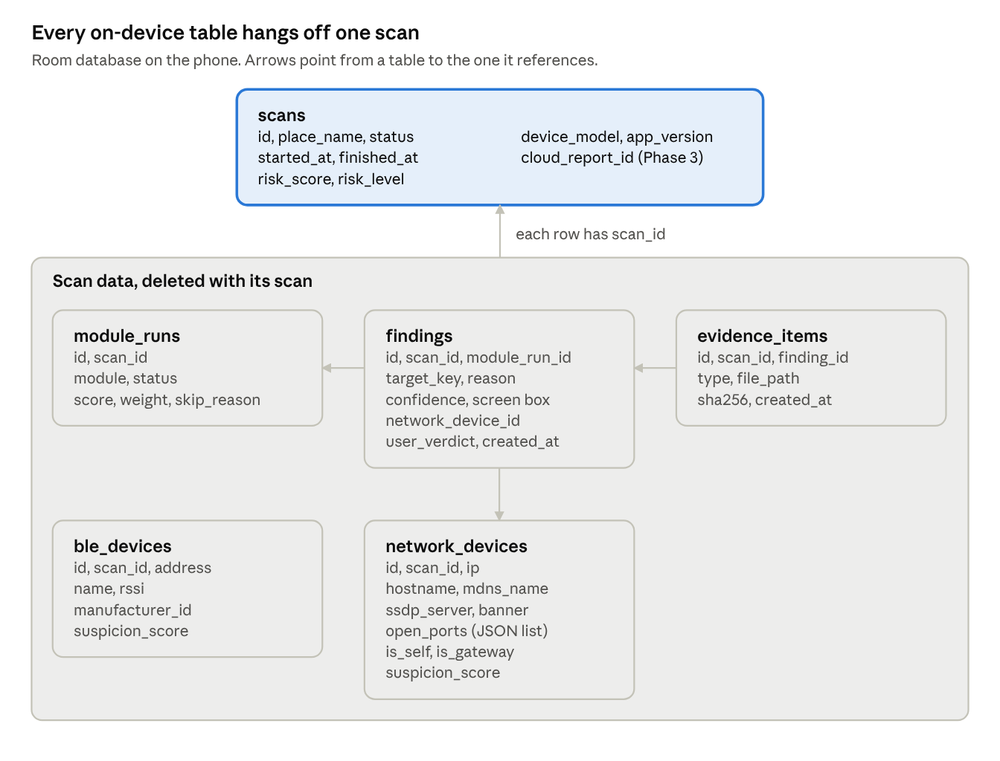
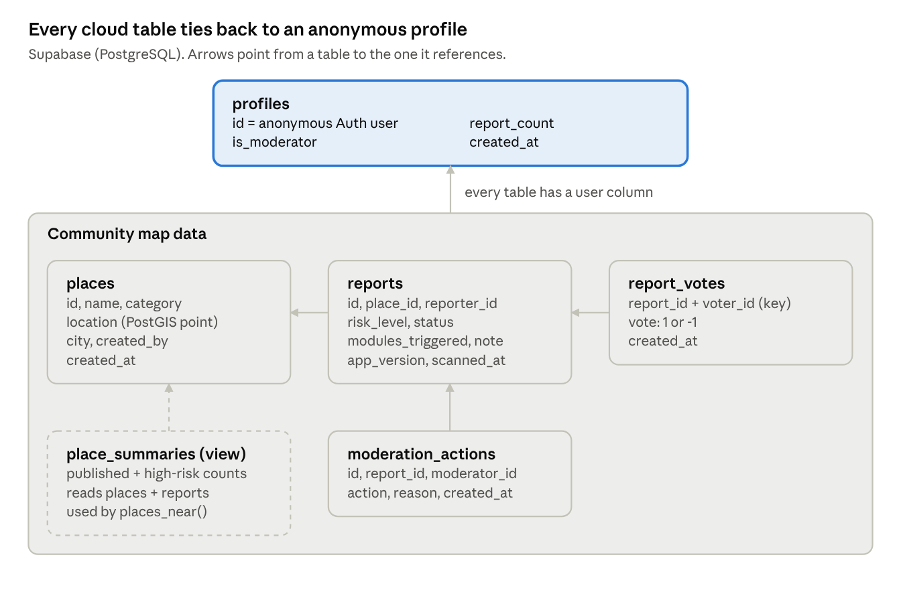

# Backend Schema: CamSense

Oct 1, 2026 · @Ninad Pandith M N

Data model for the app described in Doc: an on-device database for the MVP and a cloud backend for the Phase 3 community map.

## Decision and scope

Build the on-device Room database now and design (but don't build) a Supabase cloud backend for the Phase 3 community map. The MVP stays fully offline, and the local schema already has the hooks the cloud will need, so nothing gets rewritten later.

|  | On-device (MVP) | Cloud (Phase 3) |
|----|----|----|
| Purpose | Scan history, findings, evidence | Community map of reported places |
| Technology | Room (SQLite) on the phone | Supabase: PostgreSQL + PostGIS, Auth, REST API |
| Needs internet | No | Yes, only when a user shares a report |
| Cost | Free | Free tier |
| Build when | Weeks 1–6 | After the demo |

**Why Supabase over Firebase:** the community map needs "find reported places within 2 km of me", which PostGIS does with one indexed query. Firestore has no built-in geo queries, and a relational model (places → reports → votes) fits PostgreSQL naturally. Row-level security keeps the rules in the database, not in app code.

## Data principles

Room images, network details and the user's location never leave the phone; the cloud only ever receives a short, user-approved report about a public place.

| Data | Stored on phone | Sent to cloud |
|----|----|----|
| Camera frames | Never stored (processed in memory) | Never |
| Evidence photos | Yes, app-private folder | Never |
| IP addresses, hostnames, open ports | Yes | Never |
| Bluetooth addresses | Yes | Never |
| Place name typed by user | Yes | Only if the user shares a report |
| Place location | No | Only the place's map pin, chosen by the user when sharing |
| Risk level + which modules fired | Yes | Only if the user shares a report |
| User identity | No account needed | Anonymous Supabase account, created on first share |

**Rules for every table**

- Primary keys are UUID strings, generated on the phone, so records can later sync without ID clashes.

- Timestamps are stored as Unix milliseconds (UTC) on the phone and timestamptz in the cloud.

- Enums are stored as text, not numbers, so the data stays readable in exports and SQL.

- Deleting a scan deletes everything under it, including evidence files.

# On-device database (MVP)

## On-device relationships

On-device ER diagram · 6 tables

A scan owns everything: deleting it removes its module runs, findings, devices and evidence. Findings also point to the module run that produced them and, for Wi-Fi findings, to the device.

## On-device tables

Six tables, all hanging off scans. Device settings (IR support, magnetometer baseline, theme) live in DataStore, not in the database.

### scans

One row per guided scan.

| Field | Type | Null | Notes |
|----|----|----|----|
| id | TEXT (UUID) | No | Primary key |
| place_name | TEXT | Yes | Typed by the user, e.g. "Hotel Sunrise, room 204" |
| started_at | INTEGER | No | Unix ms |
| finished_at | INTEGER | Yes | Null while running or if aborted |
| status | TEXT | No | RUNNING, COMPLETED, ABORTED |
| risk_score | REAL | Yes | 0.0–1.0, from the RiskEngine |
| risk_level | TEXT | Yes | LOW, MEDIUM, HIGH |
| device_model | TEXT | No | Phone model, for debugging |
| app_version | TEXT | No | e.g. "1.0.0" |
| cloud_report_id | TEXT (UUID) | Yes | Set only after sharing to the community map (Phase 3) |

### module_runs

One row per module per scan (six per scan).

| Field       | Type        | Null | Notes                                          |
|-------------|-------------|------|------------------------------------------------|
| id          | TEXT (UUID) | No   | Primary key                                    |
| scan_id     | TEXT        | No   | FK → scans.id, cascade delete                  |
| module      | TEXT        | No   | GLINT, INFRARED, NETWORK, BLE, MAGNET, OBJECTS |
| status      | TEXT        | No   | DONE, SKIPPED, FAILED                          |
| score       | REAL        | Yes  | 0.0–1.0                                        |
| weight      | REAL        | No   | Weight used, copied from ScanConfig            |
| skip_reason | TEXT        | Yes  | e.g. "NO_WIFI", "IR_NOT_SUPPORTED"             |
| duration_ms | INTEGER     | Yes  | How long the module ran                        |

Unique index on (scan_id, module).

### findings

One row per thing a module flagged.

| Field | Type | Null | Notes |
|----|----|----|----|
| id | TEXT (UUID) | No | Primary key |
| scan_id | TEXT | No | FK → scans.id, cascade delete |
| module_run_id | TEXT | No | FK → module_runs.id, cascade delete |
| target_key | TEXT | Yes | Links findings about the same object across modules, e.g. "object-3" |
| reason | TEXT | No | Plain-English text shown to the user |
| confidence | REAL | No | 0.0–1.0 |
| box_left, box_top, box_right, box_bottom | REAL | Yes | Screen box (0–1 fractions) for camera findings |
| network_device_id | TEXT | Yes | FK → network_devices.id, set null on delete |
| user_verdict | TEXT | No | UNREVIEWED (default), CHECKED_OK, CONFIRMED |
| created_at | INTEGER | No | Unix ms |

Indexes on scan_id, module_run_id and target_key.

### network_devices

One row per device found on the Wi-Fi during a scan.

| Field | Type | Null | Notes |
|----|----|----|----|
| id | TEXT (UUID) | No | Primary key |
| scan_id | TEXT | No | FK → scans.id, cascade delete |
| ip | TEXT | No | e.g. "192.168.1.14" |
| hostname | TEXT | Yes | From reverse DNS or mDNS |
| mdns_name | TEXT | Yes | e.g. "IPCam-3F2A.local" |
| ssdp_server | TEXT | Yes | SSDP/UPnP server header |
| open_ports | TEXT | No | JSON list, e.g. \[554, 8080\] |
| banner | TEXT | Yes | First 200 characters of an HTTP/RTSP reply |
| is_self | INTEGER (0/1) | No | The user's own phone |
| is_gateway | INTEGER (0/1) | No | The router |
| suspicion_score | REAL | No | 0.0–1.0 |

### ble_devices

One row per Bluetooth device seen during a scan.

| Field           | Type        | Null | Notes                          |
|-----------------|-------------|------|--------------------------------|
| id              | TEXT (UUID) | No   | Primary key                    |
| scan_id         | TEXT        | No   | FK → scans.id, cascade delete  |
| address         | TEXT        | No   | Often randomized by the device |
| name            | TEXT        | Yes  | From the scan record           |
| rssi            | INTEGER     | No   | Strongest signal seen, in dBm  |
| manufacturer_id | INTEGER     | Yes  | Bluetooth SIG company ID       |
| suspicion_score | REAL        | No   | 0.0–1.0                        |

### evidence_items

One row per saved file.

| Field      | Type        | Null | Notes                                          |
|------------|-------------|------|------------------------------------------------|
| id         | TEXT (UUID) | No   | Primary key                                    |
| scan_id    | TEXT        | No   | FK → scans.id, cascade delete                  |
| finding_id | TEXT        | Yes  | FK → findings.id, set null on delete           |
| type       | TEXT        | No   | PHOTO, REPORT_JSON, REPORT_PDF                 |
| file_path  | TEXT        | No   | Relative to the app's files/evidence folder    |
| sha256     | TEXT        | No   | File hash, shows the file wasn't changed later |
| created_at | INTEGER     | No   | Unix ms                                        |

## Room code

Drop these into app/src/main/java/com/camsense/data/db/. Room stores enums by name automatically, and the converter handles the port list; the ble_devices and evidence_items entities follow the same pattern as network_devices.

**Enums and converters**

enum class ScanStatus { RUNNING, COMPLETED, ABORTED }\
enum class RiskLevel { LOW, MEDIUM, HIGH }\
enum class ModuleId { GLINT, INFRARED, NETWORK, BLE, MAGNET, OBJECTS }\
enum class RunStatus { DONE, SKIPPED, FAILED }\
enum class UserVerdict { UNREVIEWED, CHECKED_OK, CONFIRMED }\
enum class EvidenceType { PHOTO, REPORT_JSON, REPORT_PDF }\
\
class Converters {\
@TypeConverter fun fromList(v: List\<Int\>): String = Json.encodeToString(v)\
@TypeConverter fun toList(v: String): List\<Int\> = Json.decodeFromString(v)\
}

**Entities**

@Entity(tableName = "scans")\
data class ScanEntity(\
@PrimaryKey val id: String = UUID.randomUUID().toString(),\
@ColumnInfo(name = "place_name") val placeName: String?,\
@ColumnInfo(name = "started_at") val startedAt: Long,\
@ColumnInfo(name = "finished_at") val finishedAt: Long? = null,\
val status: ScanStatus = ScanStatus.RUNNING,\
@ColumnInfo(name = "risk_score") val riskScore: Float? = null,\
@ColumnInfo(name = "risk_level") val riskLevel: RiskLevel? = null,\
@ColumnInfo(name = "device_model") val deviceModel: String,\
@ColumnInfo(name = "app_version") val appVersion: String,\
@ColumnInfo(name = "cloud_report_id") val cloudReportId: String? = null\
)\
\
@Entity(\
tableName = "module_runs",\
foreignKeys = \[ForeignKey(entity = ScanEntity::class, parentColumns = \["id"\],\
childColumns = \["scan_id"\], onDelete = ForeignKey.CASCADE)\],\
indices = \[Index(value = \["scan_id", "module"\], unique = true)\]\
)\
data class ModuleRunEntity(\
@PrimaryKey val id: String = UUID.randomUUID().toString(),\
@ColumnInfo(name = "scan_id") val scanId: String,\
val module: ModuleId,\
val status: RunStatus,\
val score: Float?,\
val weight: Float,\
@ColumnInfo(name = "skip_reason") val skipReason: String? = null,\
@ColumnInfo(name = "duration_ms") val durationMs: Long? = null\
)\
\
@Entity(\
tableName = "findings",\
foreignKeys = \[\
ForeignKey(entity = ScanEntity::class, parentColumns = \["id"\],\
childColumns = \["scan_id"\], onDelete = ForeignKey.CASCADE),\
ForeignKey(entity = ModuleRunEntity::class, parentColumns = \["id"\],\
childColumns = \["module_run_id"\], onDelete = ForeignKey.CASCADE),\
ForeignKey(entity = NetworkDeviceEntity::class, parentColumns = \["id"\],\
childColumns = \["network_device_id"\], onDelete = ForeignKey.SET_NULL)\
\],\
indices = \[Index("scan_id"), Index("module_run_id"), Index("target_key"), Index("network_device_id")\]\
)\
data class FindingEntity(\
@PrimaryKey val id: String = UUID.randomUUID().toString(),\
@ColumnInfo(name = "scan_id") val scanId: String,\
@ColumnInfo(name = "module_run_id") val moduleRunId: String,\
@ColumnInfo(name = "target_key") val targetKey: String?,\
val reason: String,\
val confidence: Float,\
@ColumnInfo(name = "box_left") val boxLeft: Float? = null,\
@ColumnInfo(name = "box_top") val boxTop: Float? = null,\
@ColumnInfo(name = "box_right") val boxRight: Float? = null,\
@ColumnInfo(name = "box_bottom") val boxBottom: Float? = null,\
@ColumnInfo(name = "network_device_id") val networkDeviceId: String? = null,\
@ColumnInfo(name = "user_verdict") val userVerdict: UserVerdict = UserVerdict.UNREVIEWED,\
@ColumnInfo(name = "created_at") val createdAt: Long\
)\
\
@Entity(\
tableName = "network_devices",\
foreignKeys = \[ForeignKey(entity = ScanEntity::class, parentColumns = \["id"\],\
childColumns = \["scan_id"\], onDelete = ForeignKey.CASCADE)\],\
indices = \[Index("scan_id")\]\
)\
data class NetworkDeviceEntity(\
@PrimaryKey val id: String = UUID.randomUUID().toString(),\
@ColumnInfo(name = "scan_id") val scanId: String,\
val ip: String,\
val hostname: String? = null,\
@ColumnInfo(name = "mdns_name") val mdnsName: String? = null,\
@ColumnInfo(name = "ssdp_server") val ssdpServer: String? = null,\
@ColumnInfo(name = "open_ports") val openPorts: List\<Int\>,\
val banner: String? = null,\
@ColumnInfo(name = "is_self") val isSelf: Boolean,\
@ColumnInfo(name = "is_gateway") val isGateway: Boolean,\
@ColumnInfo(name = "suspicion_score") val suspicionScore: Float\
)

**A scan with everything under it**

data class ScanWithDetails(\
@Embedded val scan: ScanEntity,\
@Relation(parentColumn = "id", entityColumn = "scan_id") val moduleRuns: List\<ModuleRunEntity\>,\
@Relation(parentColumn = "id", entityColumn = "scan_id") val findings: List\<FindingEntity\>,\
@Relation(parentColumn = "id", entityColumn = "scan_id") val networkDevices: List\<NetworkDeviceEntity\>\
)

**DAO**

@Dao\
interface ScanDao {\
@Insert suspend fun insertScan(scan: ScanEntity)\
@Update suspend fun updateScan(scan: ScanEntity)\
@Insert suspend fun insertModuleRuns(runs: List\<ModuleRunEntity\>)\
@Insert suspend fun insertFindings(findings: List\<FindingEntity\>)\
@Insert suspend fun insertNetworkDevices(devices: List\<NetworkDeviceEntity\>)\
\
@Query("SELECT \* FROM scans WHERE status = 'COMPLETED' ORDER BY started_at DESC")\
fun observeHistory(): Flow\<List\<ScanEntity\>\>\
\
@Transaction\
@Query("SELECT \* FROM scans WHERE id = :scanId")\
fun observeScan(scanId: String): Flow\<ScanWithDetails?\>\
\
@Query("UPDATE findings SET user_verdict = :verdict WHERE id = :findingId")\
suspend fun setVerdict(findingId: String, verdict: UserVerdict)\
\
@Query("DELETE FROM scans WHERE id = :scanId")\
suspend fun deleteScan(scanId: String) // also delete files in files/evidence/\<scanId\>/\
}

**Database**

@Database(\
entities = \[ScanEntity::class, ModuleRunEntity::class, FindingEntity::class,\
NetworkDeviceEntity::class, BleDeviceEntity::class, EvidenceItemEntity::class\],\
version = 1,\
exportSchema = true\
)\
@TypeConverters(Converters::class)\
abstract class CamSenseDatabase : RoomDatabase() {\
abstract fun scanDao(): ScanDao\
abstract fun evidenceDao(): EvidenceDao\
}

## On-device sample data

This is the demo scan from the PRD: an old phone streaming from inside a tissue box, found by four modules. IDs are shortened for reading; real ones are full UUIDs. Load it into a debug build to design the results and history screens before the modules work.

INSERT INTO scans VALUES\
('scan-01', 'Demo room, lab 3', 1790865900000, 1790866170000, 'COMPLETED',\
0.82, 'HIGH', 'Pixel 7a', '1.0.0', NULL);\
\
INSERT INTO module_runs VALUES\
('run-01', 'scan-01', 'GLINT', 'DONE', 0.90, 0.30, NULL, 62000),\
('run-02', 'scan-01', 'INFRARED', 'SKIPPED', NULL, 0.15, 'NO_IR_SOURCE_SEEN', 40000),\
('run-03', 'scan-01', 'NETWORK', 'DONE', 0.85, 0.25, NULL, 28000),\
('run-04', 'scan-01', 'BLE', 'DONE', 0.10, 0.10, NULL, 20000),\
('run-05', 'scan-01', 'MAGNET', 'DONE', 0.70, 0.10, NULL, 35000),\
('run-06', 'scan-01', 'OBJECTS', 'DONE', 0.60, 0.10, NULL, 45000);\
\
INSERT INTO network_devices VALUES\
('net-01', 'scan-01', '192.168.43.1', NULL, NULL, NULL, '\[53,80\]', NULL, 0, 1, 0.05),\
('net-02', 'scan-01', '192.168.43.14', NULL, NULL, NULL, '\[8080\]',\
'HTTP/1.1 200 OK ... IP Webcam', 0, 0, 0.85),\
('net-03', 'scan-01', '192.168.43.22', NULL, NULL, NULL, '\[\]', NULL, 1, 0, 0.00);\
\
INSERT INTO findings VALUES\
('fnd-01', 'scan-01', 'run-06', 'object-1', 'Tissue box: a common place to hide a camera',\
0.78, 0.41, 0.52, 0.63, 0.71, NULL, 'UNREVIEWED', 1790865960000),\
('fnd-02', 'scan-01', 'run-01', 'object-1', 'Tiny bright reflection, like a camera lens',\
0.90, 0.52, 0.58, 0.54, 0.60, NULL, 'CONFIRMED', 1790866020000),\
('fnd-03', 'scan-01', 'run-03', NULL, 'A device on this Wi-Fi is streaming video',\
0.85, NULL, NULL, NULL, NULL, 'net-02', 'UNREVIEWED', 1790865930000),\
('fnd-04', 'scan-01', 'run-05', 'object-1', 'Strong electronics signal near this spot',\
0.70, NULL, NULL, NULL, NULL, NULL, 'UNREVIEWED', 1790866120000);\
\
INSERT INTO evidence_items VALUES\
('evd-01', 'scan-01', 'fnd-02', 'PHOTO', 'scan-01/glint_1.jpg', 'a3f1...9c2e', 1790866025000),\
('evd-02', 'scan-01', NULL, 'REPORT_JSON', 'scan-01/report.json', '7b0d...41aa', 1790866170000);

**How the score comes out:** weighted sum = 0.30×0.90 + 0.25×0.85 + 0.10×0.10 + 0.10×0.70 + 0.10×0.60 = 0.62; three findings share target_key object-1, so the 0.2 agreement bonus applies, giving 0.82. Skipped modules add nothing.

# Cloud backend (Phase 3)

## Cloud relationships

Cloud ER diagram · 5 tables + 1 view

Reports belong to a place; votes and moderator actions belong to a report. The dashed view is what the map reads, counting only published reports.

## Cloud tables

Five tables and one view in Supabase. Users are anonymous: Supabase Auth creates an account on first share, with no email or phone number.

### profiles

One row per anonymous user, created by a trigger when they first sign in.

| Field        | Type        | Null | Notes                           |
|--------------|-------------|------|---------------------------------|
| id           | uuid        | No   | PK, same as auth.users.id       |
| is_moderator | boolean     | No   | Default false                   |
| report_count | integer     | No   | Default 0; used for rate limits |
| created_at   | timestamptz | No   | Default now()                   |

### places

A public place people report on, like a hotel or trial room.

| Field | Type | Null | Notes |
|----|----|----|----|
| id | uuid | No | PK, default gen_random_uuid() |
| name | text | No | 2–120 characters |
| category | place_category | No | HOTEL, PG_HOSTEL, HOMESTAY, TRIAL_ROOM, WASHROOM, OTHER |
| location | geography(Point, 4326) | No | Map pin the user chose; indexed for distance search |
| city | text | Yes |  |
| created_by | uuid | No | FK → profiles.id |
| created_at | timestamptz | No | Default now() |

### reports

One shared scan result about a place.

| Field | Type | Null | Notes |
|----|----|----|----|
| id | uuid | No | PK; the phone generates it and stores it in scans.cloud_report_id |
| place_id | uuid | No | FK → places.id, cascade delete |
| reporter_id | uuid | No | FK → profiles.id |
| risk_level | risk_level | No | LOW, MEDIUM, HIGH |
| modules_triggered | text\[\] | No | e.g. {GLINT, NETWORK} |
| note | text | Yes | Up to 280 characters, optional |
| status | report_status | No | PENDING (default), PUBLISHED, REJECTED |
| app_version | text | No |  |
| scanned_at | timestamptz | No | When the scan happened |
| created_at | timestamptz | No | Default now() |

### report_votes

Other users confirm or dispute a report.

| Field | Type | Null | Notes |
|----|----|----|----|
| report_id | uuid | No | FK → reports.id, cascade delete; part of PK |
| voter_id | uuid | No | FK → profiles.id; part of PK (one vote per person) |
| vote | smallint | No | 1 = confirm, -1 = dispute |
| created_at | timestamptz | No | Default now() |

### moderation_actions

An audit trail of every moderator decision.

| Field        | Type        | Null | Notes                           |
|--------------|-------------|------|---------------------------------|
| id           | uuid        | No   | PK                              |
| report_id    | uuid        | No   | FK → reports.id, cascade delete |
| moderator_id | uuid        | No   | FK → profiles.id                |
| action       | text        | No   | APPROVE, REJECT, HIDE           |
| reason       | text        | Yes  |                                 |
| created_at   | timestamptz | No   | Default now()                   |

### place_summaries (view)

What the map reads: one row per place with only published reports counted.

| Field | Notes |
|----|----|
| place_id, name, category, location | From places |
| published_reports | Count of PUBLISHED reports |
| high_reports | Count of PUBLISHED reports with risk HIGH |
| last_reported_at | Latest scanned_at |

## Cloud SQL

Run these in the Supabase SQL editor, in order. Row-level security (RLS) is on for every table, so the public app key can only do what the policies allow.

**1. Extensions and types**

create extension if not exists postgis with schema extensions;\
\
create type public.place_category as enum\
('HOTEL', 'PG_HOSTEL', 'HOMESTAY', 'TRIAL_ROOM', 'WASHROOM', 'OTHER');\
create type public.risk_level as enum ('LOW', 'MEDIUM', 'HIGH');\
create type public.report_status as enum ('PENDING', 'PUBLISHED', 'REJECTED');

**2. Tables and indexes**

create table public.profiles (\
id uuid primary key references auth.users(id) on delete cascade,\
is_moderator boolean not null default false,\
report_count integer not null default 0,\
created_at timestamptz not null default now()\
);\
\
create table public.places (\
id uuid primary key default gen_random_uuid(),\
name text not null check (char_length(name) between 2 and 120),\
category public.place_category not null,\
location extensions.geography(point, 4326) not null,\
city text,\
created_by uuid not null references public.profiles(id),\
created_at timestamptz not null default now()\
);\
create index places_location_idx on public.places using gist (location);\
\
create table public.reports (\
id uuid primary key,\
place_id uuid not null references public.places(id) on delete cascade,\
reporter_id uuid not null references public.profiles(id),\
risk_level public.risk_level not null,\
modules_triggered text\[\] not null default '{}',\
note text check (char_length(note) \<= 280),\
status public.report_status not null default 'PENDING',\
app_version text not null,\
scanned_at timestamptz not null,\
created_at timestamptz not null default now()\
);\
create index reports_place_status_idx on public.reports (place_id, status);\
create index reports_reporter_idx on public.reports (reporter_id, created_at);\
\
create table public.report_votes (\
report_id uuid not null references public.reports(id) on delete cascade,\
voter_id uuid not null references public.profiles(id),\
vote smallint not null check (vote in (-1, 1)),\
created_at timestamptz not null default now(),\
primary key (report_id, voter_id)\
);\
\
create table public.moderation_actions (\
id uuid primary key default gen_random_uuid(),\
report_id uuid not null references public.reports(id) on delete cascade,\
moderator_id uuid not null references public.profiles(id),\
action text not null check (action in ('APPROVE', 'REJECT', 'HIDE')),\
reason text,\
created_at timestamptz not null default now()\
);

**3. View and nearby search**

create view public.place_summaries with (security_invoker = true) as\
select p.id as place_id, p.name, p.category, p.location,\
count(r.id) filter (where r.status = 'PUBLISHED') as published_reports,\
count(r.id) filter (where r.status = 'PUBLISHED' and r.risk_level = 'HIGH') as high_reports,\
max(r.scanned_at) filter (where r.status = 'PUBLISHED') as last_reported_at\
from public.places p\
left join public.reports r on r.place_id = p.id\
group by p.id;\
\
create function public.places_near(lat double precision, lng double precision,\
radius_m integer default 2000)\
returns setof public.place_summaries\
language sql stable as \$\$\
select s.\* from public.place_summaries s\
where s.place_id in (\
select id from public.places\
where extensions.st_dwithin(\
location,\
extensions.st_setsrid(extensions.st_makepoint(lng, lat), 4326)::extensions.geography,\
radius_m)\
);\
\$\$;

**4. Triggers: new profile, rate limit**

create function public.handle_new_user() returns trigger\
language plpgsql security definer set search_path = '' as \$\$\
begin\
insert into public.profiles (id) values (new.id);\
return new;\
end; \$\$;\
\
create trigger on_auth_user_created\
after insert on auth.users\
for each row execute function public.handle_new_user();\
\
create function public.limit_reports() returns trigger\
language plpgsql security definer set search_path = '' as \$\$\
begin\
if (select count(\*) from public.reports\
where reporter_id = new.reporter_id\
and created_at \> now() - interval '24 hours') \>= 5 then\
raise exception 'Daily report limit reached';\
end if;\
update public.profiles set report_count = report_count + 1 where id = new.reporter_id;\
return new;\
end; \$\$;\
\
create trigger reports_rate_limit\
before insert on public.reports\
for each row execute function public.limit_reports();

**5. Row-level security**

create function public.is_moderator() returns boolean\
language sql stable security definer set search_path = '' as \$\$\
select coalesce((select is_moderator from public.profiles where id = auth.uid()), false);\
\$\$;\
\
alter table public.profiles enable row level security;\
alter table public.places enable row level security;\
alter table public.reports enable row level security;\
alter table public.report_votes enable row level security;\
alter table public.moderation_actions enable row level security;\
\
create policy "own profile" on public.profiles\
for select to authenticated using (id = auth.uid());\
\
create policy "anyone reads places" on public.places\
for select to anon, authenticated using (true);\
create policy "users add places" on public.places\
for insert to authenticated with check (created_by = auth.uid());\
\
create policy "read published or own reports" on public.reports\
for select to anon, authenticated\
using (status = 'PUBLISHED' or reporter_id = auth.uid() or public.is_moderator());\
create policy "users submit pending reports" on public.reports\
for insert to authenticated\
with check (reporter_id = auth.uid() and status = 'PENDING');\
create policy "moderators update reports" on public.reports\
for update to authenticated using (public.is_moderator());\
\
create policy "anyone reads votes" on public.report_votes\
for select to anon, authenticated using (true);\
create policy "users vote as themselves" on public.report_votes\
for insert to authenticated with check (voter_id = auth.uid());\
create policy "users remove own vote" on public.report_votes\
for delete to authenticated using (voter_id = auth.uid());\
\
create policy "moderators only" on public.moderation_actions\
for all to authenticated\
using (public.is_moderator()) with check (public.is_moderator());

## Cloud sample data

Two places and three reports for testing the map. Create two anonymous test users first (their profiles appear automatically through the trigger), then paste their IDs in place of the USER_A and USER_B placeholders. Run it as the postgres role in the SQL editor, which bypasses RLS.

insert into public.places (id, name, category, location, city, created_by) values\
('11111111-0000-0000-0000-000000000001', 'Hotel Sunrise', 'HOTEL',\
extensions.st_geogfromtext('SRID=4326;POINT(72.8777 19.0760)'), 'Mumbai', 'USER_A'),\
('11111111-0000-0000-0000-000000000002', 'City Mall trial rooms', 'TRIAL_ROOM',\
extensions.st_geogfromtext('SRID=4326;POINT(72.8820 19.0800)'), 'Mumbai', 'USER_B');\
\
insert into public.reports\
(id, place_id, reporter_id, risk_level, modules_triggered, note, status, app_version, scanned_at) values\
('22222222-0000-0000-0000-000000000001', '11111111-0000-0000-0000-000000000001', 'USER_A',\
'HIGH', '{GLINT,NETWORK,MAGNET}', 'Lens found inside the smoke detector in room 204.',\
'PUBLISHED', '1.2.0', '2026-10-01 20:15+05:30'),\
('22222222-0000-0000-0000-000000000002', '11111111-0000-0000-0000-000000000001', 'USER_B',\
'MEDIUM', '{GLINT}', null, 'PENDING', '1.2.0', '2026-10-02 09:40+05:30'),\
('22222222-0000-0000-0000-000000000003', '11111111-0000-0000-0000-000000000002', 'USER_B',\
'LOW', '{}', 'Scanned 3 trial rooms, nothing found.', 'PUBLISHED', '1.2.0', '2026-10-02 18:05+05:30');\
\
insert into public.report_votes (report_id, voter_id, vote) values\
('22222222-0000-0000-0000-000000000001', 'USER_B', 1);

**Check it works:** select \* from public.places_near(19.0760, 72.8777, 2000); should return both places, with Hotel Sunrise showing 1 published report and 1 high report (the pending one isn't counted).

## Sync flow

Nothing syncs automatically. Data goes up only when a user taps "Share to community map" on a finished scan, and only what they see on the preview screen.

1.  User taps Share on a completed scan.

2.  The app signs in anonymously with Supabase Auth if it hasn't already (first time only).

3.  The user picks the place: the app calls places_near() for their pin and offers matching places within 50 m, or lets them add a new one.

4.  The app shows a preview: place, risk level, which modules fired, and an optional note. No photos, IPs or device details.

5.  On confirm, the app generates a report UUID, inserts the report (status PENDING) and saves the same UUID in scans.cloud_report_id.

6.  A moderator approves it; only then does it count on the map.

7.  If there's no internet, the app shows "Couldn't share right now. Try again later" and nothing is queued in the background.

**Mapping from phone to cloud**

| Phone (Room) | Cloud (Supabase) |
|----|----|
| scans.cloud_report_id | reports.id |
| scans.risk_level | reports.risk_level |
| module_runs where score ≥ 0.5 | reports.modules_triggered |
| scans.finished_at | reports.scanned_at |
| scans.place_name | Prefills places.name (user can edit) |
| findings, network_devices, ble_devices, evidence_items | Never sent |

## Migrations and versioning

Every schema change gets a version bump and a written migration, on both sides; never edit an old migration.

|  | On-device (Room) | Cloud (Supabase) |
|----|----|----|
| Where versions live | @Database(version = N) | supabase/migrations/ folder, one timestamped .sql file per change |
| Schema history | exportSchema = true writes JSON to app/schemas/, committed to Git | Supabase CLI: supabase migration new, supabase db push |
| Adding a column | AutoMigration(from = N, to = N+1) | alter table ... add column in a new migration file |
| Renames or type changes | Manual Migration object with SQL | New migration file with the SQL |
| Testing | MigrationTestHelper in androidTest | Run migrations on a second free project first |
| During development | Allowed: fallbackToDestructiveMigration() in debug builds only | Reset with supabase db reset locally |

**Rules**

- Never ship fallbackToDestructiveMigration() in a release build; users would lose their scan history and evidence.

- The sample data files live in app/src/debug/assets/ and supabase/seed.sql, so they never reach users.

- Free Supabase projects pause after 7 days without database activity; open the dashboard or run one query before a demo.

## Sources

Checked on 1 Oct 2026:

- [Supabase pricing](https://supabase.com/pricing): Free plan with 500 MB database per project, 2 active projects, pause after 1 week of inactivity

- [Supabase free tier limits, Sept 2026](https://dev.to/nayankyada/supabase-pricing-2026-free-tier-limits-compute-costs-when-to-upgrade-52af): limits unchanged as of September 2026
