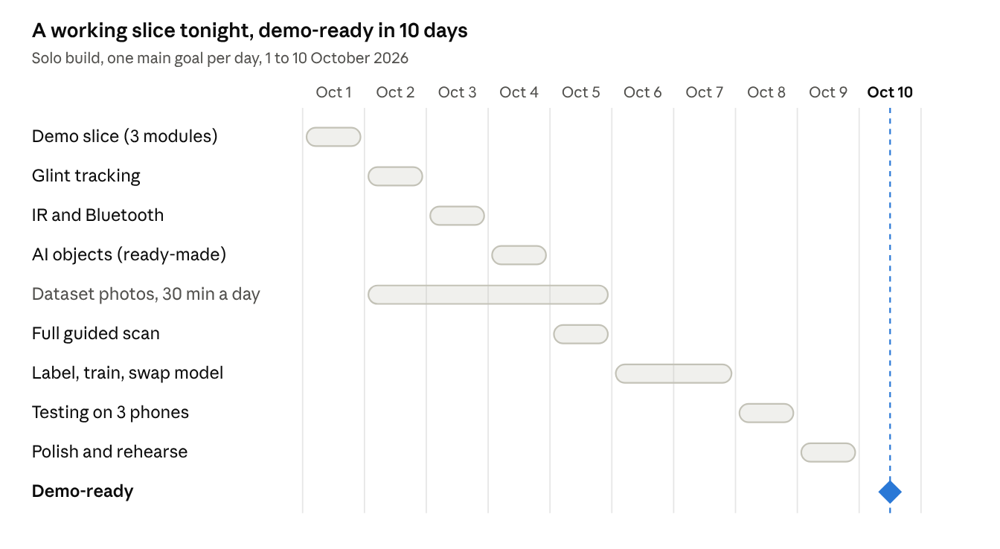

# Implementation Plan: CamSense

Oct 1, 2026 · @Ninad Pandith M N

Solo build of the CamSense MVP: a working demo slice today and the full MVP demo-ready by Oct 10, 2026. Built from Doc, Doc, Doc and Doc.

## Plan at a glance

By tonight you'll have a working app that catches the hidden phone through three modules. The full six-module MVP takes 10 days, because the custom AI model needs photos collected, labelled and trained; the coding itself goes fast with Claude Code.

| Milestone | When | What works |
|----|----|----|
| Demo slice | Day 1, Thu 1 Oct | Wi-Fi scan, magnetometer, basic lens glint, risk result screen |
| All modules running | Day 4, Sun 4 Oct | \+ IR, Bluetooth, AI objects (using a ready-made model) |
| Complete app | Day 7, Wed 7 Oct | \+ full guided flow, evidence, history, custom AI model |
| Demo-ready | Day 10, Sat 10 Oct | Tested on 3 phones, polished, demo script rehearsed |

**Changes from the earlier docs**

- **Timeline:** 10 days solo instead of the PRD's 6 weeks with a team. Assumes about 8 focused hours a day.

- **AI model:** start with a ready-made YOLO26n model trained on everyday objects (it already knows clocks, books, TVs, phones, vases). Swap in the custom 8-class model on Day 7. The demo works either way.

- **Dataset target:** about 100 photos per class (800 total) instead of 150–250, to fit the schedule.

- **Scope:** MVP only. The cloud backend and all Phase 2 features wait until after the demo.

## Timeline

Build timeline · 1–10 October 2026

Days 1–5 build every module while dataset photos pile up in the background; Days 6–7 turn those photos into the custom model; Days 8–10 are for testing, polish and rehearsal.

## Day 1 (today): the demo slice

Goal for tonight: the app finds the hidden phone through the Wi-Fi scan, the magnetometer and a basic lens-glint check, and shows a risk result. About 8 hours in seven blocks; each block ends with the app running on your phone and a Git commit.

**Block 1 · Setup (45 min)**

- [ ] Install or update Android Studio, Git, Python 3.11+ and Claude Code

- [ ] Turn on USB debugging on your main phone and connect it

- [ ] Install IP Webcam on the old phone, start the stream, open its URL on your laptop to confirm it works

- [ ] Create the project: Empty Activity (Compose), package com.camsense, min SDK 29

- [ ] Create a private GitHub repo, add CLAUDE.md from the Tech Stack doc, first commit

**Block 2 · App skeleton (1 h)**

- [ ] Charcoal lime theme: colours and fonts from the Content Guidelines

- [ ] Screens: Welcome → Network check → Close check → Results (placeholders)

- [ ] core/DetectionModule.kt, ModuleResult, Finding, and scoring/ScanConfig.kt

- [ ] Manifest permissions and one runtime permission request screen

**Block 3 · M3 Wi-Fi scan (1.5 h)**

- [ ] Read own IP and subnet; parallel scan of the /24 subnet for ports 554, 80, 8080, 8000, 1935

- [ ] Read the first 200 characters of any open HTTP port

- [ ] List devices on the Network check screen; flag the old phone's port 8080

- [ ] Gate: the hidden phone shows up as a suspicious device

**Block 4 · M5 Magnetometer (45 min)**

- [ ] Baseline for 3 seconds, then beep and vibrate faster as the field rises

- [ ] Live meter on the Close check screen

- [ ] Gate: clear difference between the box with the phone and an empty box

**Block 5 · M1 Lens glint, basic (2 h)**

- [ ] CameraX preview + ImageAnalysis with the torch on

- [ ] OpenCV: grayscale, threshold, contours, keep small bright round spots

- [ ] Draw red circles on the preview (tracking across frames comes Day 2)

- [ ] Gate: the old phone's lens gets circled from 1 m in a dim room

**Block 6 · Scoring and results (1 h)**

- [ ] RiskEngine: weighted sum from ScanConfig (skipped modules count as 0)

- [ ] Results screen with Low / Medium / High, icon, word and reasons, using the copy from the Content Guidelines

- [ ] Room: scans and module_runs tables only, save each finished scan

**Block 7 · Wrap-up (30 min)**

- [ ] Full run-through with the hidden phone; screen-record it as a backup demo video

- [ ] Write tomorrow's first task in CLAUDE.md under "Current focus"

- [ ] Commit and push

**If you fall behind:** skip Block 6's Room saving (results still show on screen) and do it on Day 5.

## Days 2–10

Each day has one main goal and ends with a gate. Every day from Day 2 to Day 5, spend 30 minutes taking photos for the dataset so it's ready on Day 6.

### Day 2 · Fri 2 Oct · Glint that doesn't lie

- [ ] Record 3 dark-room videos of the hidden phone and 3 of an empty room

- [ ] Tune thresholds in prototype/glint_prototype.py on those videos

- [ ] BlobTracker: keep spots that stay small and steady across 5+ frames

- [ ] Port tuned values into ScanConfig; unit tests for BlobTracker

- [ ] 30 min dataset photos (smoke detectors, chargers, clocks)

- [ ] Gate: glint finds the lens in 9 of 10 tries at 1–2 m, and flags nothing in the empty-room videos

### Day 3 · Sat 3 Oct · IR and Bluetooth

- [ ] IR calibration screen with a TV remote; save the result in DataStore

- [ ] M2 IR analyzer on the front camera; skip cleanly if unsupported

- [ ] M4 BLE scan for 20 s; flag strong unknown signals

- [ ] 30 min dataset photos (frames, tissue boxes, air purifiers)

- [ ] Gate: TV remote glow is flagged; BLE list shows nearby devices

### Day 4 · Sun 4 Oct · AI objects (ready-made model)

- [ ] Export the stock yolo26n model to LiteRT in Colab; add it to assets

- [ ] ObjectDetector + YoloPostProcessor; map boxes onto the preview

- [ ] Show only relevant classes (clock, book, tv, cell phone, vase, potted plant) as "check this"

- [ ] 30 min dataset photos (alarm clocks, holes in walls)

- [ ] Gate: all six modules run on the phone

### Day 5 · Mon 5 Oct · The full guided scan

- [ ] All six steps in order, with the exact copy from the Content Guidelines

- [ ] Full Room schema from the Backend Schema doc: findings, network_devices, ble_devices, evidence_items

- [ ] target_key linking and the agreement bonus in RiskEngine

- [ ] Evidence mode: save photo + JSON report with SHA-256 hash

- [ ] Last 30 min of dataset photos; upload everything to Roboflow

- [ ] Gate: a full scan runs start to finish and is saved in history

### Day 6 · Tue 6 Oct · Dataset and training

- [ ] Label about 800 images (100 per class) in Roboflow; add public images to fill gaps

- [ ] Train yolo26n in Colab (about 100 epochs); note the mAP

- [ ] While it trains: history screen, delete scan, "Checked, it's fine" button

- [ ] Gate: model trained with mAP@50 of 0.60 or higher (0.70 is the PRD target; improve later)

### Day 7 · Wed 7 Oct · Custom model in the app

- [ ] Export to LiteRT (INT8), swap it in, update labels.txt

- [ ] Check speed; drop to 320 px input if below 15 fps

- [ ] Error and empty states from the Content Guidelines

- [ ] Gate: the tissue box and smoke detector get labelled live

### Day 8 · Thu 8 Oct · Testing

- [ ] Run the PRD test table: distances, 10 clean rooms, IR remote

- [ ] Borrow 2 more Android phones and run full scans

- [ ] Tune weights and thresholds from the results; log every change

- [ ] Gate: fewer than 1 false High in 10 clean-room scans

### Day 9 · Fri 9 Oct · Polish

- [ ] Accessibility pass: TalkBack labels, 200% font size, vibration feedback

- [ ] Dark-sweep UI dimming, one lime button per screen, icon + word on every risk

- [ ] App icon and splash screen

- [ ] Two full rehearsals of the demo script from the PRD

### Day 10 · Sat 10 Oct · Demo-ready

- [ ] Morning buffer for anything that slipped

- [ ] Slides, project report and a fresh backup demo video

- [ ] Signed release APK installed on the demo phone

- [ ] Gate: the full demo runs 3 times in a row without a problem

## Claude Code prompts

Paste these at the start of each build step. Each asks for a plan first, so you approve before any code is written. Export the four docs as Markdown into a docs/ folder in the repo so Claude Code can read them.

**Skeleton (Day 1, Block 2)**

Read CLAUDE.md and docs/. Set up the app skeleton: Charcoal lime theme\
(colours and fonts from docs/content-guidelines.md), Compose navigation with\
placeholder screens Welcome, NetworkCheck, CloseCheck, Results, plus\
core/DetectionModule.kt, ModuleResult, Finding and scoring/ScanConfig.kt\
exactly as in docs/tech-stack.md. Plan first and list the files.

**Wi-Fi scan (Day 1, Block 3)**

Build modules/network per docs/tech-stack.md: get own IP and /24 subnet,\
scan ports 554, 80, 8080, 8000, 1935 on every host with coroutines\
(Dispatchers.IO, 64 in parallel, 300 ms timeout), read the first 200\
characters of open HTTP ports, compute suspicion_score, and expose results\
through DetectionModule. Handle ACCESS_LOCAL_NETWORK for API 37. Show the\
device list on NetworkCheck. Plan first.

**Magnetometer (Day 1, Block 4)**

Build modules/magnetometer: 3 s baseline, then field magnitude minus\
baseline drives a beep rate (ToneGenerator) and vibration. Add a live meter\
composable on CloseCheck. Thresholds go in ScanConfig. Plan first.

**Lens glint (Day 1, Block 5)**

Build modules/glint: CameraX Preview + ImageAnalysis (KEEP_ONLY_LATEST)\
with the torch on. Convert the Y plane to an OpenCV Mat, threshold near 250,\
find contours, keep blobs 2-15 px with circularity above 0.7, and draw red\
circles on the preview. Always close the ImageProxy. Plan first.

**Scoring and results (Day 1, Block 6)**

Build scoring/RiskEngine: combine() all module result flows, weighted sum\
with weights from ScanConfig, skipped modules count as 0, map to LOW/MEDIUM/\
HIGH per docs/prd.md. Results screen must follow the risk messaging table in\
docs/content-guidelines.md exactly. Save scans and module_runs with Room per\
docs/backend-schema.md. Add RiskEngine unit tests. Plan first.

**Glint tracking (Day 2)**

Add BlobTracker to modules/glint: match blobs across frames by nearest\
centroid, confirm a blob after 5 frames where it stays small and steady,\
drop it after 3 missed frames. Use the thresholds I tuned (pasted below).\
Write unit tests with synthetic blob sequences. Plan first.

**AI objects (Day 4)**

Build modules/objects: load assets/models/\*.tflite with LiteRT, resize\
frames to the model input, run YOLO26n (check whether the export already removes duplicate boxes;\
if not, add simple NMS), map boxes to preview\
coordinates, and show only the classes listed in ScanConfig as lime "check\
this" boxes. Keep it fast enough for 15 fps. Plan first.

**When something breaks**

This fails on my phone. Here's the exact Logcat output: \<paste\>.\
Explain the cause in two sentences, then fix it with the smallest change.

**After each module works**

Explain this module line by line as if I have to defend it in a viva.\
Then list what could go wrong in a live demo.

## Definition of done

A task counts as done only when all five are true:

1.  It runs on your real phone, not just in the IDE.

2.  Its tuning numbers are in ScanConfig, not buried in code.

3.  Any on-screen words match the Content Guidelines.

4.  Pure logic has unit tests (trackers, scoring, post-processing).

5.  You can explain how it works without looking, and it's committed and pushed.

**The MVP is done** when the PRD demo script runs 3 times in a row and every PRD success metric is met, except AI accuracy, where 0.60 mAP is acceptable for the first demo.

## Risks, cut order and fallbacks

If a day slips, cut features in this order rather than pushing the demo date. The demo still works with only the first three modules.

**Cut order (first to go at the top)**

1.  App icon, splash screen and extra polish

2.  Bluetooth scan (M4): lowest weight, rarely fires

3.  Custom AI model: keep the ready-made model

4.  IR check (M2): demo it separately with the TV remote

5.  Scan history screen: results still work

Never cut Wi-Fi scan, lens glint, magnetometer, risk result or evidence save; they carry the demo.

**Risks**

| Risk | Sign | Fallback |
|----|----|----|
| Glint gives false alarms | Empty-room videos still get circled | Raise the frame count to 8; demo in a room with fewer shiny surfaces |
| Hotspot blocks device-to-device traffic | Network scan finds nothing | Use a home router, or a laptop hotspot with client isolation off |
| Model export or speed problems | Crash on load or under 10 fps | Export at 320 px, or fall back to YOLO11n |
| Labelling takes too long | Fewer than 500 labels by Day 6 midday | Train on what you have plus public images; label more after the demo |
| AI-written code you can't explain | Stuck in a viva question | Run the "explain line by line" prompt after every module |
| Burnout from 8-hour days | Missing two gates in a row | Use Day 10's buffer; cut from the list above |
| Demo-day failure | Anything | Play the backup video recorded on Days 1 and 10 |

## After the demo

Once the MVP is demo-ready, these come next, in order of value for effort:

| Item | From | Rough effort |
|----|----|----|
| Improve AI model to 0.70 mAP with 150–250 photos per class | PRD | 3–4 days |
| PDF export of the evidence report | PRD Phase 2 | 1 day |
| Multilingual UI (Hindi and other Indian languages) | PRD Phase 2 | 2 days per language |
| ToF/LiDAR sensor boost for lens detection on supported phones | PRD Phase 2 | 3–5 days |
| ESP32 Wi-Fi traffic-spike add-on | PRD Phase 2 | 1 week + about ₹500 hardware |
| Community map on Supabase | Backend Schema | 1–2 weeks |
| Play Store release (privacy policy, listing, testing track) | New | 3–4 days |
