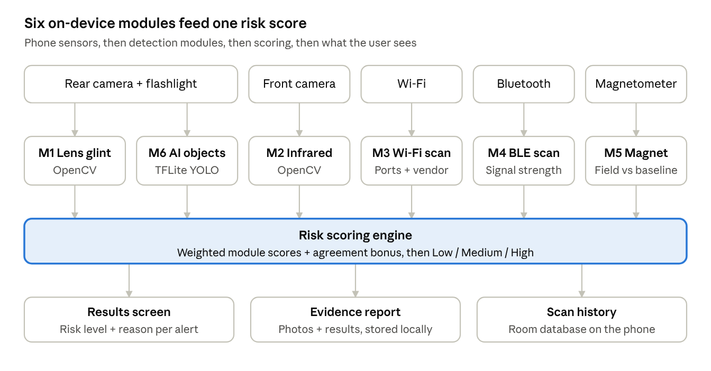
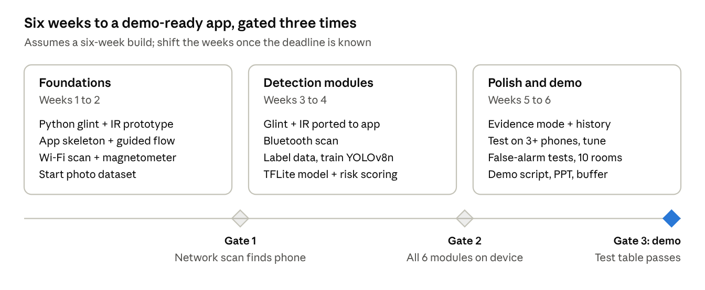

# PRD: CamSense — Hidden Camera Detection App

Oct 1, 2026 · @Ninad Pandith M N

## Overview and problem statement

CamSense is an Android app that detects hidden cameras in a room using only the sensors already in a normal smartphone. It runs six independent checks and combines them into one risk score, so users can sweep a hotel room, PG or changing room in under five minutes.

**The problem.** Hidden cameras are regularly found in hotel rooms, rented rooms, trial rooms and washrooms, and the footage is often leaked or used for blackmail. Dedicated RF or lens detectors cost money and are rarely carried. Existing detector apps mostly rely on a single weak signal, such as the magnetometer, and produce many false alarms.

**The solution.** Combine six detection methods that each catch a different kind of camera:

1.  Lens reflection (glint) detection with the flashlight

2.  Infrared (night-vision LED) detection with the front camera

3.  Wi-Fi network scan with port and service fingerprinting

4.  Bluetooth Low Energy scan

5.  Magnetometer sweep for close-range confirmation

6.  AI detection of objects commonly used to hide cameras

**Project context.** Student project built largely with AI-assisted coding ("vibe coding"). The demo uses an old Android phone running a streaming app as a simulated Wi-Fi spy camera, so no hardware purchase is required.

## Goals, non-goals and success metrics

The MVP succeeds if it reliably finds the simulated camera in the demo room through at least three modules, with few false alarms in a normal room.

**Goals**

- Detect common hidden cameras using only a smartphone, with no extra hardware required

- Give non-technical users a guided scan that takes under 5 minutes

- Keep all scanning on-device so no room images leave the phone

- Explain every alert (which module fired and why) so users can verify it themselves

**Non-goals (for the MVP)**

- Guaranteed detection of every camera type (wired, non-IR, SD-card-only cameras stay hard to catch)

- iOS support

- Detecting audio-only bugs or GPS trackers

- Community map and cloud features

**Success metrics**

| Metric | Target |
|----|----|
| Detection of the demo camera (lens glint, 1–3 m, dim room) | 9 of 10 trials |
| Demo camera found by network scan when on same Wi-Fi | 10 of 10 trials |
| False "High risk" results in a clean room | Under 1 in 10 scans |
| Full guided scan time | Under 5 minutes |
| AI object detector accuracy on test set (mAP@50) | 0.70 or higher |
| Frame processing speed on a mid-range phone | 15 fps or higher |

## Target users and personas

The primary user is a non-technical traveller or tenant, especially a woman, staying in an unfamiliar room.

| Persona | Situation | What they need |
|----|----|----|
| Priya, 24, solo traveller | Checks into budget hotels and homestays on work trips | A fast, simple scan she trusts before unpacking |
| Rahul, 20, student | Moving into a new PG or shared flat | A one-time thorough sweep of his room and bathroom |
| Meena, 45, family traveller | Stays in rented holiday homes with family | Clear yes/no guidance without technical jargon |
| Hotel or PG owner | Wants to prove rooms are safe for guests | A scan report they can show guests |

## User stories

1.  As a traveller, I want a step-by-step scan so that I can check a room without knowing how cameras work.

2.  As a user, I want the app to point out objects where cameras are usually hidden so that I know where to look.

3.  As a user, I want to see suspicious bright spots circled on screen so that I can inspect them closely.

4.  As a user, I want to know if an unknown camera-like device is on the hotel Wi-Fi so that I can catch cameras that stream remotely.

5.  As a user, I want the phone to beep faster near hidden electronics so that I can confirm a suspicious object.

6.  As a user, I want a clear Low / Medium / High result with reasons so that I know whether to act.

7.  As a user, I want to save photos and scan results as evidence so that I can report the camera to management or police.

8.  As a user, I want the app to work offline so that I can scan anywhere and my room images stay private.

## Scope: MVP vs later phases

The MVP ships all six detection modules, the guided scan and evidence mode on Android; cloud and hardware add-ons come later.

| Feature | MVP | Phase 2 | Phase 3 |
|----|----|----|----|
| Guided scan flow | Yes |  |  |
| Lens glint detection | Yes | Uses ToF/LiDAR sensor on supported phones |  |
| IR detection (front camera) | Yes |  |  |
| Wi-Fi scan + port fingerprinting | Yes |  |  |
| Bluetooth scan | Yes |  |  |
| Magnetometer sweep | Yes |  |  |
| AI hiding-object detection | Yes | Pinhole zoom-in model |  |
| Risk score + results screen | Yes |  |  |
| Evidence mode (photos + report) | Yes | PDF export |  |
| Wi-Fi traffic-spike detection (ESP32 add-on) |  | Yes |  |
| Multilingual UI (Hindi, Kannada, Tamil, etc.) |  | Yes |  |
| Community map of flagged places |  |  | Yes |
| iOS version (reduced features) |  |  | Yes |

## Functional requirements per detection module

Each module runs independently, returns a confidence score from 0 to 1, and lists the evidence behind it.

### M1: Lens glint detection

- FR-1.1: Turn on the flashlight and use the rear camera at 720p, processing at least 15 frames per second.

- FR-1.2: Find small bright spots (roughly 2–15 px, near-saturated brightness) in each frame.

- FR-1.3: Track each spot across at least 5 frames; keep spots that stay small and point-like as the phone moves.

- FR-1.4: Reject large or smeared reflections (glass, mirrors, metal) using size, shape and blinking behaviour.

- FR-1.5: Circle confirmed candidates on the live preview and let the user save a snapshot.

### M2: Infrared detection

- FR-2.1: Run a one-time calibration using a TV remote to check whether the front camera sees IR.

- FR-2.2: If supported, ask the user to darken the room and scan with the front camera.

- FR-2.3: Flag small glowing spots (purple or white) that appear only in darkness.

- FR-2.4: If the phone cannot see IR, skip this module and say so on the results screen.

### M3: Wi-Fi network scan

- FR-3.1: Discover devices on the connected network using a ping sweep, mDNS and UPnP/SSDP.

- FR-3.2: Look up each device's MAC vendor (OUI) against a bundled database of camera and IoT chip makers; flag randomized MACs as "unknown".

- FR-3.3: Check common camera ports: 554 (RTSP), 80/8080/8000 (HTTP/ONVIF), 1935 (RTMP).

- FR-3.4: Where a port is open, request the service banner or page to identify video streams.

- FR-3.5: Exclude the user's own phone and the router from results.

### M4: Bluetooth scan

- FR-4.1: Scan nearby BLE devices for 20 seconds.

- FR-4.2: Flag devices with camera-related names or manufacturer IDs, or unknown devices with strong signal (above -60 dBm, meaning very close).

### M5: Magnetometer sweep

- FR-5.1: Record a baseline magnetic reading away from objects.

- FR-5.2: Beep and vibrate faster as the reading rises above baseline.

- FR-5.3: Mark this module as "confirmation only" in scoring, since it is noisy and works only within a few centimetres.

### M6: AI hiding-object detection

- FR-6.1: Run an on-device object detector on the live camera feed.

- FR-6.2: Detect these classes: smoke detector, USB charger/adapter, wall clock, photo frame, tissue box, air purifier, alarm clock, and wall or ceiling hole.

- FR-6.3: Label each detected object on screen with a "check this" prompt that links to M1 and M5.

### Shared features

- FR-7.1: Evidence mode saves timestamped photos, module results and the risk score in a local report.

- FR-7.2: Results screen shows the overall risk level and, for each alert, the module and reason.

- FR-7.3: Scan history lists past scans with date, place name (typed by user) and result.

## Guided scan flow and UX

The user follows six steps with one instruction per screen; the app runs the automatic checks in the background.

1.  **Start scan:** user types a place name (optional) and grants camera, location (needed for Wi-Fi scans on Android) and Bluetooth permissions.

2.  **Network check (automatic, about 30 s):** Wi-Fi and Bluetooth scans run while the next step begins.

3.  **Room sweep (lights on):** user pans slowly around the room; AI labels likely hiding objects.

4.  **Dark sweep (lights off):**

    1.  IR check with the front camera

    2.  Lens glint check with the rear camera and flashlight

5.  **Close inspection:** app lists flagged objects; user holds the phone near each one for the magnetometer check.

6.  **Results:** risk level, reasons per module, flagged photos, and a "Save evidence" button.

**UX principles**

- One instruction per screen, with a short animation showing what to do.

- Plain language: "Possible camera lens found" rather than technical terms.

- Always show why something was flagged, and let users mark a result as "Checked, it's fine".

- Large buttons and high contrast so it works in a dark room.

## Risk scoring logic

The overall risk is a weighted sum of module scores, with a bonus when independent modules agree on the same object.

| Module          | Weight | Reason                                         |
|-----------------|--------|------------------------------------------------|
| M1 Lens glint   | 0.30   | Catches almost every camera type               |
| M3 Wi-Fi scan   | 0.25   | Strong signal when an open video port is found |
| M2 Infrared     | 0.15   | Only catches night-vision cameras              |
| M6 AI objects   | 0.10   | Points to hiding spots, not cameras themselves |
| M4 Bluetooth    | 0.10   | Few cameras use BLE                            |
| M5 Magnetometer | 0.10   | Noisy; confirmation only                       |

\text{Risk} = \sum_i w_i s_i + 0.2 \cdot \text{agreement}

Here s is each module's score (0 to 1) and agreement is 1 when two or more modules flag the same object (for example, a glint inside an AI-labelled smoke detector plus a magnetometer spike), otherwise 0. The result is capped at 1.

| Risk score | Level | What the app says |
|----|----|----|
| Below 0.3 | Low | No clear signs of a camera found |
| 0.3 to 0.6 | Medium | Some signs found; check the flagged spots |
| Above 0.6 | High | Strong signs of a hidden camera; save evidence and report |

Weights and thresholds are starting values and will be tuned during testing.

## Non-functional requirements

| Area | Requirement |
|----|----|
| Privacy | All camera frames processed on-device; no images or network data uploaded; evidence stored only locally |
| Performance | Camera modules run at 15 fps or more on a mid-range phone (about 4 GB RAM) |
| Compatibility | Android 10 (API 29) and above |
| Battery | A full scan uses under 5% battery |
| App size | Under 50 MB including the AI model |
| Offline | Every MVP feature works without internet |
| Accessibility | Works in a dark room: large text, high contrast, vibration and sound feedback |
| Reliability | If a module fails or is unsupported, the scan continues and the results screen says which module was skipped |
| Ethics | App only scans; it never accesses, logs into or disrupts other people's devices |

## Technical architecture and stack

A native Android app in Kotlin runs every module on the phone and sends module scores to one scoring engine; nothing goes to a server.

CamSense architecture · 5 sensors, 6 modules, 1 scoring engine

The rear camera feeds two modules (glint and AI objects); each other sensor feeds one. All six report to the scoring engine, which drives the results, evidence and history screens.

| Layer | Choice |
|----|----|
| Language and UI | Kotlin, Jetpack Compose, MVVM pattern |
| Camera | CameraX (ImageAnalysis for live frames) |
| Image processing | OpenCV Android SDK |
| On-device AI | TensorFlow Lite running a YOLOv8-nano model |
| Wi-Fi scan | Socket-based ping sweep and port checks, NsdManager for mDNS, UDP multicast for SSDP, bundled IEEE OUI vendor list |
| Bluetooth | Android BluetoothLeScanner |
| Magnetometer | Android SensorManager (magnetic field sensor) |
| Local storage | Room database for history; app-private folder for evidence photos |
| Prototyping | Python + OpenCV on a laptop webcam to tune glint and IR thresholds |
| Model training | Python, Ultralytics YOLOv8, Google Colab, Roboflow for labelling |
| AI coding assistant | Claude Code, one module per session |

## AI model and dataset plan

Fine-tune YOLOv8-nano on about 2,000 labelled images of 8 hiding-object classes, then export it to TensorFlow Lite for on-device use.

| Step | Details |
|----|----|
| Classes | Smoke detector, USB charger/adapter, wall clock, photo frame, tissue box, air purifier, alarm clock, wall/ceiling hole |
| Starting data | Search Roboflow Universe and Open Images for existing labelled images of these objects |
| Own photos | About 150–250 images per class from hostel rooms, homes and shops; vary angle, distance and lighting (including dim) |
| Labelling | Roboflow (free tier) with bounding boxes |
| Augmentation | Brightness, blur, rotation and noise to mimic dark rooms and shaky hands |
| Split | 70% train, 20% validation, 10% test |
| Training | Google Colab free GPU, pretrained YOLOv8n weights, about 100 epochs |
| Export | TensorFlow Lite with INT8 quantization to keep the model under 10 MB |
| Target | mAP@50 of 0.70 or higher and 15 fps or more on device |

The glint and IR modules use classic OpenCV rules rather than a trained model, so they need threshold tuning but no dataset.

## Testing and demo plan

**Test setup.** An old Android phone running IP Webcam or DroidCam acts as the hidden Wi-Fi camera, placed inside a tissue box or a cardboard "smoke detector" with a small hole for the lens. A TV remote simulates an IR night-vision LED.

| Test | Method | Pass condition |
|----|----|----|
| Glint detection | Scan the hidden phone from 1, 2 and 3 m in a dim room, 10 trials each | Found in 9 of 10 trials at 1–2 m |
| IR detection | Point the TV remote at the scanner phone's front camera | Glow flagged every time on supported phones |
| Network scan | Hidden phone streaming on same hotspot | Device flagged with open port 8080 |
| Magnetometer | Hold the scanner near the box, then near an empty box | Clear difference between the two |
| AI detection | Held-out test images plus live room pans | mAP@50 of 0.70 or higher |
| False alarms | Full scan of 10 clean rooms (hostel, home, classroom) | Under 1 "High" result |
| Device coverage | Run on at least 3 different Android phones | All modules work or skip gracefully |

**Live demo script (about 3 minutes)**

1.  Show the hidden phone's live feed on a laptop so judges see the room is being recorded.

2.  Run the guided scan on the scanner phone.

3.  Network check flags the streaming device.

4.  AI labels the tissue box as a likely hiding spot.

5.  Lights off: lens glint is circled on screen; the TV remote triggers the IR module.

6.  Magnetometer confirms the box; the results screen shows High risk with reasons.

7.  Save evidence and show the report.

## Timeline and milestones

A six-week build reaches a demo-ready app, with a gate at the end of every two weeks that must pass before moving on.

Build roadmap · 3 phases, 3 gates

If Gate 2 slips, cut Bluetooth and scan history first; the glint, network and AI modules carry the demo.

## Risks, limitations and mitigations

| Risk or limitation | Impact | Mitigation |
|----|----|----|
| Wired, non-IR cameras recording to an SD card show no network or IR signal | Missed detections | Rely on lens glint plus AI hiding-spot prompts; state this limit clearly in the app |
| Reflective surfaces create false glints | False alarms | Multi-frame tracking, size and shape filters, and the agreement bonus in scoring |
| Newer Android versions restrict MAC addresses and network info | Weaker vendor lookup | Rely more on port and service fingerprinting |
| Front cameras on some phones block IR | IR module unusable | Calibration step detects this and skips the module |
| Magnetometer noise from phone case, metal furniture | False spikes | Baseline calibration; confirmation-only weight |
| Small custom dataset | Lower AI accuracy | Start from public datasets; heavy augmentation |
| Vibe-coded code the team cannot explain | Weak viva or judging | Ask the AI to explain each module; team reviews and documents every module |
| App misused to scan others' networks | Ethical and legal concerns | Scan only the network the user is on; read-only checks; no login attempts |

## Open questions

- [ ] Is this for a hackathon, a mini project or a final-year project? This decides the timeline and how much documentation is needed.

- [ ] What is the deadline or demo date?

- [ ] How many people are on the team, and who owns which modules?

- [ ] Does the team know Kotlin, or should we use Flutter?

- [ ] Which Android phones are available for building and testing (model and Android version)?

- [ ] Is the name "CamSense" final, or should it be changed?

- [ ] Should Phase 2 features (ESP32 traffic sniffing, multilingual UI) be attempted before the demo?
